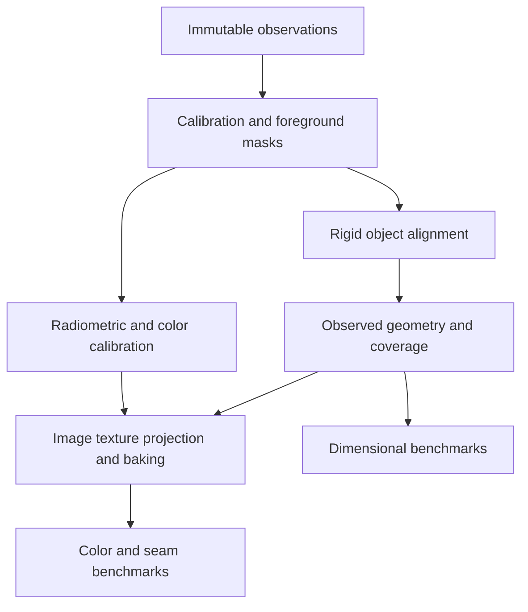

# Object scanner system specification

Date: 2 November 2026. Owner's intended use: personal experimentation with a
likely Matterport Pro2; exact model and installed firmware await inspection.

## Intended result

A local scanner that acquires one stationary RGB/depth observation on demand,
waits while the operator reorients the object, and reconstructs its exterior
across those observations. The deliverable is a dimensionally benchmarked
model with calibrated color, a coverage record, and reproducible source data.
An orbiting camera or a turntable can provide additional capture geometries.
People need a separate motion-aware capture profile and validation protocol.

Hardware and processing additions follow measured shortcomings. Preserve the
Pro2's useful capabilities, identify its actual limits, and compare each
addition against a repeatable baseline.

## Current implementation and evidence

| Component | State in this branch |
| --- | --- |
| Existing local capture and sweep unpacking | Upstream implementation; not tested against the owner's camera |
| Stationary single-set trigger and motor independence | Firmware research; unverified |
| Pro2 depth scale, calibrated sensor rays, and color/depth extrinsics | Unresolved; required before native metric reconstruction |
| HDR/exposure/iris/depth/GPS controls | Requested capability set; setters remain unverified |
| Foreground extraction | Required explicit input mask; automatic segmentation is future work |
| Automatic registration | Implemented FPFH/RANSAC initialization, robust ICP, overlap gates, pose graph |
| Marker-assisted/manual initialization | Implemented 3D correspondence or rigid-pose seed inputs |
| Fusion | Implemented metric voxel fusion, linear color averaging, independent-pass counts |
| Surface reconstruction | Implemented ball-pivoted observational mesh; open boundaries retained |
| Color foundation | Implemented explicit transfer functions, chart matrix, held-out CIEDE2000 reporting, linear HDR helper |
| Exports | Linear NPZ master, observed point cloud, colored PLY mesh, millimetre STL, provenance/QA JSON |
| Accuracy foundation | Independent ball-center lengths, sphere fit residuals, surface comparison, repeated-acquisition statistics |
| First-view setup preview | Stored-image original-pixel detail check and calibrated foreground distance report |
| Low-detail coverage preview | First exposure per angle, bounded coarse mesh, offline rotatable viewer, and review gate |
| High-resolution image texture atlas | Design specified below; not implemented |
| Integrated capture/coverage/measurement UI | Offline preview views implemented; capture-app integration remains future work |
| Physical accuracy or professional color performance | Await independent real-camera benchmarks |

The offline foundation accepts already calibrated point clouds. It does not
interpret raw Pro2 panoramic depth strips as ordinary pinhole RGB-D frames.
The raw depth units, sensor geometry, and exposure metadata must be established
from real data before that adapter can be implemented faithfully.

## Capture controls

| Subsystem | Required behavior | Verification needed |
| --- | --- | --- |
| Acquisition | Trigger one set, preserve it, return to ready, retry with a new acquisition ID | Fixed-view operation and useful stationary depth |
| HDR | On/off, bracket count, spacing, individual exposures, optional merge | Bracket availability, response curve, metadata association |
| Exposure | Exposure time, sensor gain, auto/manual, exposure lock | Units, limits, effective values from actual frames |
| Aperture | Iris setting when physically adjustable | Lens module identity and iris mechanism |
| Ranging | Depth acquisition and projector enable, available timing/exposure parameters | Independent sensor controls and raw access |
| Depth processing | Validity/confidence masks, calibrated range filters, outlier settings | Meaning of auxiliary channels and native filtering |
| GPS | Receiver on/off, fix/status, separate geotag policy | Receiver power/enable command and persistence behavior |
| Motion | Motor enable, heading, bounded orbit/turntable indexing when supported | Encoder semantics, motor commands, mechanical behavior |
| Presets | Save requested and returned settings; associate each with every observation | Firmware capability discovery and readback |

Expose hardware capability states as verified, unsupported by identified
hardware, or unverified. A successful HTTP response alone does not establish
that a setting changed. Test a known scene and inspect effective acquisition.

## Reconstruction architecture

The [preview workflow](PREVIEW_WORKFLOW.md) places first-view setup inspection
before collecting all angles, then coarse 3D coverage review before full
processing. Review hashes bind inputs/settings and become stale after changes.
The draft model supports coverage decisions; dimensional and final color
evaluation occur during full reconstruction.

### 1. Ingestion and calibration

Retain original sweep containers, JPEG XR frames, IR/range/auxiliary channels,
decoded masters, timestamps, camera identity, firmware, settings, checksums,
and calibration versions. Derived previews remain reproducible derivatives.

Determine depth units from independent known distances across the working
volume. Recover each sensor's projection/ray model, lens distortion, RGB/depth
transforms, angular ordering, timing, and motor/encoder relationship. Measure
reprojection error throughout the field of view and at several distances.
Store a separate calibration for every physically changed sensor arrangement.

The native adapter must output calibrated sensor-frame points, color encoding,
foreground masks, optional normals/confidence, and provenance. A new LiDAR or
RGB camera implements the same observation contract with its own calibration.

### 2. Object alignment

Exclude the light box, hands, supports, and stationary background before fitting
object motion. Fiducials used for object pose must move rigidly with the object
or provide an independently known relation to it. Markers on the room alone do
not describe the motion of a reoriented object.

Initialize with object markers/manual correspondences or global geometric
features. Refine rigidly with robust ICP; use multiple overlaps and loop
closures to reduce accumulated drift. Reject disconnected passes. Offer manual
correspondence correction for symmetric, smooth, or low-overlap objects.
Retain an operator review step because a low registration residual can still
represent a symmetric but incorrect alignment.

Maintain metric scale during alignment. A deliberate scale calibration is a
versioned calibration operation, evaluated afterward against a separate
artifact. Never fit scale to the artifact used to report validation error.

### 3. Geometry and coverage

Retain observed samples and per-pass support alongside the mesh. The current
independent-pass count measures support, not a probability of correctness or a
complete surface-coverage percentage.

The full coverage view should combine sample support, sensor angle, estimated
noise, depth discontinuities, and visibility. It should identify areas needing
another orientation, including the underside and contact/support regions.
Absolute completeness requires a reference surface or a stated external
coverage protocol; a scan cannot enumerate every surface it never observed.

Use conservative observed-surface reconstruction for measurement. A separate
print-preparation derivative can fill holes, simplify, and repair topology;
record inferred surfaces, edits, and dimensional changes. The observational
master remains available for measurement and repeatable evaluation.

### 4. Professional color and texture processing

The current chart matrix and held-out color metrics provide a testable starting
point. The full image pipeline must additionally implement and validate:

1. Black-level correction, response/transfer-function characterization,
   flat-field and lens-shading correction, and per-sensor color calibration.
2. A stable, measured lighting setup; neutral/color references captured under
   the same light, exposure mode, filters, and optical configuration.
3. Verified exposure/gain association and radiometric HDR merge. Brackets
   requiring motion compensation need alignment/deghosting. Flag saturation
   and underexposure where information cannot be recovered.
4. Consistent white balance and color space across all sensors and passes.
   Preserve scene-linear high-bit-depth masters. Avoid independent per-frame
   contrast stretches in reconstruction inputs.
5. Visibility-aware projection of calibrated source images onto geometry:
   depth-buffer occlusion, boundary rejection, sharpness, incidence angle,
   resolution, clipping, and specular-view rejection guide image selection.
6. Robust overlap exposure balancing constrained by the reference chart,
   seam selection, and multiband blending. Evaluate seams before and after
   correction so local color variation is preserved.
7. A high-resolution UV atlas, texture baking, consistent global display
   rendering, and glTF/GLB plus OBJ/MTL texture exports. Keep illumination and
   material/base-color interpretations explicit. Cross-polarized diffuse and
   unpolarized/specular captures need separate appearance products.
8. Held-out chart measurements and independent seam checks, reporting mean,
   95th-percentile, and maximum CIEDE2000 error, neutral error, clipped pixels,
   sharpness, and effective texture sampling.

The implemented HDR helper requires already aligned linear frames. It is not
connected to Pro2's unverified exposure sequence. The 16-bit TIFF decoder output
alone does not establish a linear sensor response or an unprocessed RAW image.

## Benchmark protocol

Set acceptance tolerances before each experiment, for the intended object size
and use. No submillimetre camera-performance claim is established at this point.
Proposed future quality targets must remain labelled targets until measured.

| Property | Reference or procedure | Report |
| --- | --- | --- |
| Scale and lengths | Independent calibrated ball bar/fixture, known dimensions, or characterized scale artifact | Signed/absolute mm error and relative percent error |
| Form | Characterized spheres, planes, steps, and holes | Radius/flatness/form residuals, edge and small-feature recovery |
| Repeatability | At least three independently acquired complete scans; increase sample count for a defensible study | Bias, sample standard deviation, range, conditions |
| Reproducibility | Different days, warm-up states, placements, and operators when relevant | Variation between condition groups |
| Surface fidelity | Independently characterized reference surface with fixed metric scale | Bidirectional residual distributions and coverage |
| Registration | Controlled marker geometry and repeated loops | Inlier residuals, overlap, loop error, incorrect symmetric fits |
| Color | Measured chart references and held-out patches under declared lighting/white point | CIEDE2000 mean/p95/max and neutral error |
| Texture consistency | The same physical regions seen from multiple views | Seam error, exposure drift, blur, ghosting, clipping |
| Print preparation | Observational master versus repaired/exported model | Units, topology, inferred areas, dimensions before/after edits |

Vary range, object size, orientation, location within the capture volume, and
surface class. Include matte light/dark, textured, glossy, thin, and partially
occluded surfaces. Log environmental conditions and fixture/reference
uncertainties. Color charts and dimensional artifacts used for calibration must
be separate from the data used to claim validation performance.

The current sphere fitter uses robust orthogonal residuals as a practical
baseline. Sphere-center estimates can be biased by scanner error and limited
surface coverage; validate the method itself against characterized fixtures.
The current reference-only guard band is deliberately labelled as such. A full
measurement uncertainty budget must include acquisition, calibration, fitting,
registration, thermal, and reference contributions. Nearest-sample surface
metrics also depend on reference sampling density.

## Addressing measured shortcomings

| Observed shortcoming | Processing response | Hardware candidate to benchmark |
| --- | --- | --- |
| Unstable color or seams | Response calibration, chart profile, overlap balancing | Stable illumination, chart, light monitoring |
| Specular contamination | View rejection and separate appearance layers | Cross-polarization and diffuse lighting |
| Insufficient photographic detail | Calibrated higher-resolution image projection | Additional RGB camera or suitable optics |
| Coarse/noisy close-range geometry | Calibrated fusion and uncertainty-aware filtering | Short-range structured-light/laser-triangulation sensor or appropriate LiDAR |
| Difficult pose recovery | Better overlap and marker/manual initialization | Object-mounted marker carrier, encoder, indexed fixture |
| Missing bottom/contact surfaces | Reposition and fuse a new pass | Minimal support fixture or suspension appropriate to the object |
| Human motion | Motion detection, shorter acquisition, reject incompatible passes | Synchronized multiple views or faster auxiliary sensors |

Choose an added sensor from the required range, precision, field of view, timing,
and interfaces. Validate extrinsics, scale, time alignment, and mutual infrared
interference. Compare baseline and augmented configurations against the same
independent fixtures. A sensor's name or marketing resolution is insufficient.

## Delivery gates

1. **Camera access:** Confirm model/firmware, local capture/readback, immutable
   source preservation, and one measured conventional baseline.
2. **Stationary control:** Establish fixed-view acquisition and identify working
   HDR/exposure/ranging/GPS settings, recording unsupported/unverified controls.
3. **Native calibration:** Validate depth units, sensor rays, RGB/depth extrinsics,
   exposure interpretation, masks, and the Pro2 observation adapter.
4. **Object reconstruction:** Validate multi-orientation alignment, underside
   capture, coverage review, meshing, explicit units, and independent dimensions.
5. **Image texture and color:** Implement the full image pipeline above, test
   source-image projection and UV baking, and validate real chart/seam results.
6. **Targeted augmentation:** Select additions from the benchmark failures and
   repeat calibration, reconstruction, color, and dimensional evaluations.
7. **Integrated workflow:** Capture -> reposition -> coverage review -> alignment
   review -> reconstruction -> color/measurement QA -> exports and report.

## Works cited

Open3D. "Multiway Registration." *Open3D 0.19.0 Documentation*,
https://www.open3d.org/docs/release/tutorial/pipelines/multiway_registration.html.
Accessed 2 Nov. 2026.

Colour Developers. "colour.delta_E." *Colour 0.4.7 Documentation*,
https://colour.readthedocs.io/en/latest/generated/colour.delta_E.html.
Accessed 2 Nov. 2026. The implementation is pinned to Colour 0.4.6 for this
tested environment; the cited API documents the color-difference metric.

Rachakonda, Prem K., Bala Muralikrishnan, and Daniel S. Sawyer. "Sources of
Errors in Structured Light 3D Scanners." *NIST*, 15 Apr. 2019,
https://www.nist.gov/publications/sources-errors-structured-light-3d-scanners.
Accessed 2 Nov. 2026.

Franaszek, Marek, Geraldine S. Cheok, and Kamel S. Saidi. "Gauging the
Repeatability of 3D Imaging Systems by Sphere Fitting." *IEEE Transactions on
Instrumentation and Measurement*, 2009. *NIST*,
https://www.nist.gov/publications/gauging-repeatability-3d-imaging-systems-sphere-fitting.
Accessed 2 Nov. 2026.

Federal Agencies Digital Guidelines Initiative. "Technical Guidelines for
Digitizing Cultural Heritage Materials." 3rd ed., 2023,
https://www.digitizationguidelines.gov/guidelines/digitize-technical.html.
Accessed 2 Nov. 2026. Used as a reference for controlled image quality and
evaluation; no FADGI conformance is claimed for this scanner.
